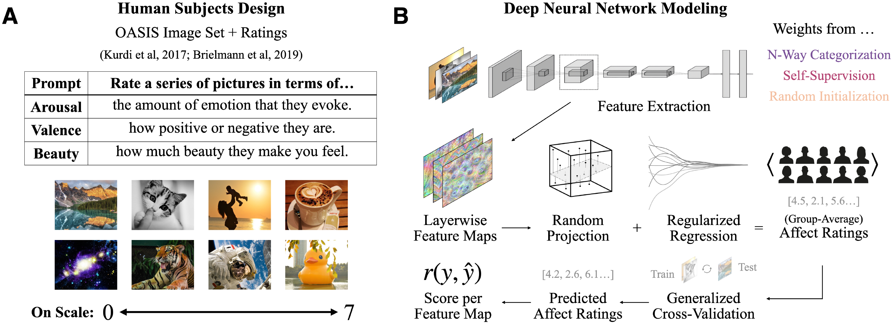
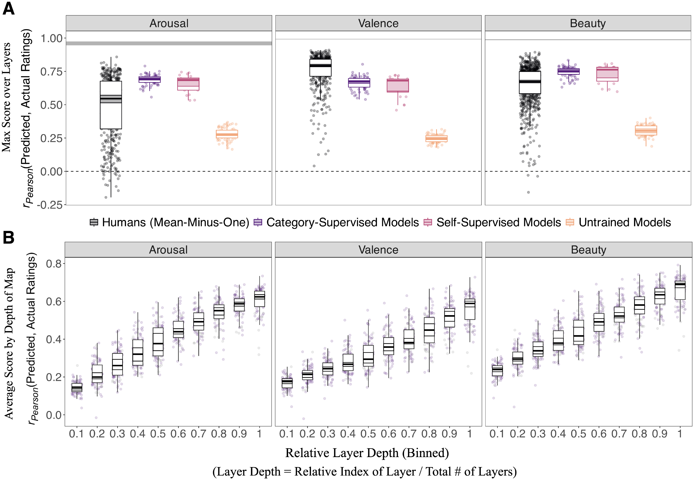

# Intro (Roadmap)

::: {.lead}
In the [introductory workshop](https://colinconwell.github.io/ML4HL-Workshop/), we built learning machines out of single geometric moves: tilt a flat line, draw a boundary, group nearby dots, or project high-dimensional clouds onto flat shadows. What happens when the phenomena we study refuse to sit still along flat axes — when two pixels, two words, or two clinical risk factors reverse each other's meaning depending on context, or when raw photographs, audio recordings, and sentences arrive without tidy spreadsheet columns? Deep learning answers by stacking many simple coordinate warps end to end, letting the model build its own intermediate features on the way to a prediction. In this tutorial, we explore the intuitions that make depth work, run practical PyTorch and Hugging Face workflows across tables, images, and text, inspect what models learn inside, and turn open-source model zoos into controlled experiments for the human sciences.
:::

**How to use this page.** Every figure with a play button, slider, or 3D sphere is live: drag handles, rotate spaces, toggle layers, and read the status strip beneath each canvas. The code blocks run real [PyTorch](https://pytorch.org), [Hugging Face](https://huggingface.co), [OpenCLIP](https://github.com/mlfoundations/open_clip), and [scikit-learn](https://scikit-learn.org) analyses on open empirical datasets. Prefer to run and modify the code yourself? The [generated notebook opens directly in Google Colab](https://colab.research.google.com/github/ColinConwell/DL4HL-Workshop/blob/main/DL4HL-Tutorial.ipynb) with all interactive figures intact. [Download the source and notebook](https://github.com/ColinConwell/DL4HL-Workshop).

<details>
<summary>Abbreviations Used in the Figures</summary>

**MLP** means multilayer perceptron (a network of stacked weighted sums and bends); **ReLU** means rectified linear unit (a simple hinge that stays flat at zero below a threshold and rises in a straight line above it); and **GELU** means Gaussian error linear unit (a smooth, rounded version of that hinge used in modern language and vision models). **CNN** means convolutional neural network, **ViT** means Vision Transformer, and **LLM** means large language model. **LoRA** means low-rank adaptation (training a tiny side-channel of weights while keeping a pretrained model frozen). **SAE** means sparse autoencoder (unpacking mixed hidden states into a wider checklist of sparse themes), **MACO** means magnitude-constrained optimization (synthesizing clean visual prototypes for what a neuron prefers), **SRP** means sparse random projection (fast distance-preserving compression), and **RDM** means representational dissimilarity matrix.

</details>

::: {.roadmap}
<div class="sup"><strong>Depth, Nonlinearity, &amp; Disentanglement</strong><small>stack layers, unknot data, &amp; bend hinges</small></div>
<div class="sup"><strong>Tabular Deep Learning</strong><small>PyTorch engines with skorch &amp; torchmetrics</small></div>
<div class="sup"><strong>Vision &amp; Feature Visualization</strong><small>transfer learning, graph tracing, &amp; MACO</small></div>
<div class="unsup"><strong>LLMs &amp; Mechanistic Interpretability</strong><small>token trajectories, LoRA, &amp; sparse dictionaries</small></div>
<div class="comp"><strong>Multimodal Probes &amp; Vector Search</strong><small>CLIP sphere alignment &amp; BYO-coefficient queries</small></div>
<div class="eval"><strong>Encoding, Decoding, &amp; Model Zoology</strong><small>DeepDive hierarchies &amp; opportunistic experiments</small></div>
:::

```{python}
#| label: setup
#| code-fold: true
#| code-summary: "Setup: imports, thread bounds, & the dl4hl helper"
import os
import sys

# Keep CPU thread counts modest so multi-model cells run smoothly on laptops and cloud runtimes.
N_JOBS = int(os.environ.get("DL4HL_N_JOBS", "2"))
N_THREADS = int(os.environ.get("DL4HL_THREADS", "2"))
for _thread_variable in ("OMP_NUM_THREADS", "OPENBLAS_NUM_THREADS", "MKL_NUM_THREADS"):
    os.environ[_thread_variable] = str(N_THREADS)
os.environ.setdefault("TOKENIZERS_PARALLELISM", "false")

import dl4hl  # Installed locally, or bundled by the generated Colab setup.
from dl4hl import show
from dl4hl.samples import widget_sample

import numpy as np
import pandas as pd
import matplotlib.pyplot as plt
import seaborn as sns
import torch
from threadpoolctl import threadpool_limits

torch.set_num_threads(N_THREADS)
_thread_limit = threadpool_limits(limits=N_THREADS)

# Initialize once-per-page widget assets and unified Matplotlib light/dark plot styling.
dl4hl.reset_assets()
dl4hl.set_style()
dl4hl.enable_theme_plots()
C = dl4hl.COLORS
rng = np.random.default_rng(2026)
DEVICE = torch.device("cuda" if torch.cuda.is_available() else "cpu")
```

**Research Domains in This Tutorial.** Each section pairs interactive simulations with executable PyTorch analyses on public datasets across the human sciences:

::: {.field-grid}
<div class="field-card"><h4>Anthropology: household surveys &amp; visual culture</h4><p>World Bank Living Standards Measurement Study (LSMS) commune-grouped household expenditure; Gapminder Dollar Street domestic photography projected onto natural-language anchor queries.</p></div>
<div class="field-card orange"><h4>Developmental &amp; clinical psychology</h4><p>Stanford Wordbank MacArthur–Bates CDI infant vocabulary trajectories; Infant Health and Development Program (IHDP) perinatal risk and childhood reading achievement.</p></div>
<div class="field-card green"><h4>Music therapy, affect, &amp; aesthetics</h4><p>Cowen et al. 13-dimensional listener emotion ratings across 1,841 musical excerpts; Kurdi et al. Open Affective Standardized Image Set (OASIS) beauty, valence, and arousal judgments.</p></div>
<div class="field-card"><h4>Perception, psycholinguistics, &amp; pragmatics</h4><p>Blender ShapeCentral 3D objects with surface-texture foils; Floyd et al. (2023) parametric Kiki–Bouba sound-symbolism shapes; 28,619 straight vs. sarcastic news headlines.</p></div>
:::

# Depth, Nonlinearity, & Disentanglement

Deep networks rely on two distinct design ingredients — **depth** (stacking layers one after another) and **nonlinearity** (putting a bend or hinge inside each unit) — and neither does the job of the other:

| Ingredient | What it does | What happens without the other |
|---|---|---|
| **Depth** (stacking hidden layers) | Feeds the output of one layer into the next, **folding space that has already been folded**. | **Depth without bends** collapses right back into a single straight line: a straight-line function of a straight-line function is still just one flat line, no matter how many layers you stack. |
| **Nonlinearity** (hinges or smooth bends) | Lets each unit change slope past a threshold instead of staying perfectly straight. | **Bends without depth** (one wide layer) place flat creases across the raw input space all at once — fine for a single curve or four corners, strained when patterns nest or twist around each other. |

## What Makes a Deep Network Deep?

In [Part 1](https://colinconwell.github.io/ML4HL-Workshop/), a **linear perceptron** (`0 hidden layers`) multiplied inputs by weights, added them up, and drew **one straight cut** across the plane. What changes as we insert **1 hidden layer** or **2 hidden layers** between the inputs and the final prediction?

- **0 hidden layers (Part 1's perceptron)** draw a single straight line — great when two groups already sit on opposite sides of the plane, hopeless when one group surrounds another.
- **Stacked layers *without* bends (`Linear (no bend)`)** look deep on a wiring diagram, yet accomplish nothing new: feeding weighted sums straight into weighted sums simplifies down into one ordinary straight line.
- **1 hidden layer *with* bends** places a handful of straight creases across the input sheet and combines them once — enough to fence off one central region, yet unable to carve multiple nested rings with only four units.
- **2 hidden layers *with* bends** make the network genuinely deep: Layer 2 places creases across *Layer 1's already-folded space*, carving inner and outer rings cleanly with a compact set of weights.

Try these combinations in Figure 1 below: compare **0 Hidden (Perceptron)**, **1 Hidden Layer**, and **2 Hidden Layers** on **Nested Rings**, then switch **Unit bend** to **Linear (no bend)** on the 2-hidden-layer network to watch all 37 weights collapse immediately into one straight cut:

```{python}
#| label: w-deep-mlp
#| echo: false
show("deep_mlp")
```

A few lines of PyTorch make both halves of that lesson concrete — first showing that three stacked linear layers produce the exact same numbers as a single linear layer, then showing how inserting `ReLU` hinges between layers multiplies the number of distinct regions the network can carve:

```{python}
#| label: depth-vs-nonlinearity-proof
import torch.nn as nn

torch.manual_seed(7)
x_demo = torch.randn(5, 2)  # 5 example 2D points

# Build three linear layers in sequence: 2 inputs -> 4 units -> 4 units -> 1 output.
layer1 = nn.Linear(2, 4, bias=False)
layer2 = nn.Linear(4, 4, bias=False)
layer3 = nn.Linear(4, 1, bias=False)

with torch.no_grad():
    # 1. Pass points through all 3 linear layers WITHOUT any bend in between.
    three_layer_linear = layer3(layer2(layer1(x_demo)))

    # Multiply the three weight tables together into one single 2-weight rule.
    single_equivalent_rule = layer3.weight @ layer2.weight @ layer1.weight
    one_line_output = x_demo @ single_equivalent_rule.T
    max_diff = (three_layer_linear - one_line_output).abs().max().item()
    print(f"3-layer linear stack (28 weights) vs. 1 flat line (2 weights) -> max difference: {max_diff:.2e}")

    # 2. Now insert ReLU bends between those same layers and count distinct regions across a 2D grid.
    grid_pts = torch.stack(torch.meshgrid(torch.linspace(-1.5, 1.5, 80), torch.linspace(-1.5, 1.5, 80), indexing="ij"), dim=-1).reshape(-1, 2)
    hidden_1 = torch.relu(grid_pts @ layer1.weight.T + torch.tensor([-0.4, 0.2, -0.3, 0.5]))
    hidden_2 = torch.relu(hidden_1 @ layer2.weight.T + torch.tensor([0.2, -0.3, 0.4, -0.2]))

    # Each unique pattern of active (> 0) vs. inactive (0) hinges marks a distinct flat region on the plane.
    regions_1layer = np.unique((hidden_1.numpy() > 0), axis=0).shape[0]
    regions_2layer = np.unique(np.hstack([hidden_1.numpy() > 0, hidden_2.numpy() > 0]), axis=0).shape[0]
    print(f"Distinct regions carved across the plane -> 1 hidden ReLU layer: {regions_1layer} | 2 hidden ReLU layers: {regions_2layer}")
```

## Deep Learning as Disentanglement

Why keep stacking four, twelve, or fifty layers in modern vision and language models? Picture pulling two strings of holiday lights — one blue strand, one orange strand — out of a box twisted tightly around each other. Try separating them in a single chop with a flat ruler and you slice right through both cords. Try yanking every loop at once and the knot cinches tighter. Instead, you loosen one outer loop, rotate a twist slightly, slide a strand free, and repeat — **unknotting one loop at a time**.

Each layer in a deep network applies that kind of gentle step-by-step adjustment, handing a slightly looser arrangement to the next layer. Press **play** or scrub **Depth** from `L0` to `L4` in Figure 2 below to watch two intertwined spiral strands pull apart across four hidden layers while a single straight-line classifier climbs from near-chance to complete separation:

```{python}
#| label: w-manifold-untangle
#| echo: false
show("manifold_untangle")
```

Real sensory measurements start out tangled in much the same way. Two photographs of the same person under harsh side-lighting versus soft shade can differ more in raw pixel brightness than photographs of two strangers under matching light; two recordings of a lullaby sung in different pitch registers can differ across almost every raw audio bin. Depth lets a network peel away nuisance variation — pose, lighting, pitch register, phrasing — step by step until the categories or quantities we care about can be separated by a simple straight line at the top.

::: {.callout-tip .takeaway title="Takeaway #1"}
Deep networks untangle complex patterns step by step across layers, applying a sequence of simple folds and shifts until target categories or quantities can be read out with a straight line.
:::

## What Is a Nonlinearity? Spline Regression as Learnable Hinges

Now let's zoom inside a single hidden unit to see what that crucial "bend" actually looks like. In spline regression from [Part 1](https://colinconwell.github.io/ML4HL-Workshop/), we bent a straight regression line by placing **knots** along the horizontal axis where the slope was allowed to change.

A neural network's **activation function** does the exact same job with learnable knot positions. A **rectified linear unit (ReLU)** is a simple hinge: it outputs zero below its threshold and rises in a straight line above it. Smooth cousins like **GELU** and **Tanh** round off that sharp corner while serving the same purpose — letting a weighted sum of simple local bends trace out smooth curves.

Switch the **Activation** toggle in Figure 3 below to **Linear** first — notice how even twelve hidden units collapse onto one straight line — then switch to **ReLU** or **GELU** and press **play** (or drag the orange knot handles along the bottom axis):

```{python}
#| label: w-activation-splines
#| echo: false
show("activation_splines")
```

We see this directly on real child-development data when modeling early productive vocabulary growth from 8 to 30 months in the Stanford Wordbank repository (`load_wordbank`). First, let's load the checklist records, inspect the age and vocabulary columns, and compare a straight line against a 6-knot cubic spline using 5-fold cross-validation:

```{python}
#| label: wordbank-load-and-baselines
from sklearn.linear_model import RidgeCV
from sklearn.model_selection import KFold, cross_val_score
from sklearn.pipeline import make_pipeline
from sklearn.preprocessing import SplineTransformer, StandardScaler

# Load American English MacArthur-Bates CDI administrations (ages 8 to 30 months).
wb = dl4hl.load_wordbank()

# Keep `ages` as a 2-column-style (N, 1) table because both scikit-learn and PyTorch layers expect a feature column.
ages = wb[["age"]].to_numpy(dtype=np.float32)
vocab = wb["vocab_share"].to_numpy(dtype=np.float32)

print(f"Wordbank rows: {len(wb):,} | ages shape: {ages.shape} ({ages.min():.0f}-{ages.max():.0f} mos) | vocab_share range: [{vocab.min():.2f}, {vocab.max():.2f}]")

# Compare a flat straight line against a fixed-knot cubic spline across the same 5 cross-validation folds.
cv5 = KFold(5, shuffle=True, random_state=0)
linear_r2 = cross_val_score(make_pipeline(StandardScaler(), RidgeCV()), ages, vocab, cv=cv5).mean()
spline_r2 = cross_val_score(
    make_pipeline(SplineTransformer(n_knots=6, degree=3), RidgeCV()), ages, vocab, cv=cv5
).mean()
print(f"5-fold R² — straight line: {linear_r2:.3f} | 6-knot cubic spline: {spline_r2:.3f}")
```

Next, let's fit a small one-hidden-layer PyTorch network (`12` ReLU hinges) to those same children's trajectories, printing tensor shapes, training error over time, and where along the 8–30 month window the network placed its hinges:

```{python}
#| label: wordbank-pytorch-relu
torch.manual_seed(2026)

# Center and scale age so the initial random hinge thresholds start near the middle of the age range.
age_mean, age_std = float(ages.mean()), float(ages.std())
age_z = (ages - age_mean) / age_std

# Convert NumPy arrays into PyTorch tensors of shape (N, 1).
x_t = torch.from_numpy(age_z)
y_t = torch.from_numpy(vocab[:, None])
print(f"PyTorch tensors -> x_t: {tuple(x_t.shape)} | y_t: {tuple(y_t.shape)}")

# One hidden layer of 12 learnable ReLU hinges combined by a final linear output layer.
relu_curve = nn.Sequential(
    nn.Linear(in_features=1, out_features=12),
    nn.ReLU(),
    nn.Linear(in_features=12, out_features=1),
)
opt = torch.optim.Adam(relu_curve.parameters(), lr=0.03)

for step in range(1, 251):
    opt.zero_grad()                                      # 1. clear previous step's adjustments
    loss = nn.functional.mse_loss(relu_curve(x_t), y_t)  # 2. predict vocabulary & measure squared error
    loss.backward()                                      # 3. trace how each weight contributed to the error
    opt.step()                                           # 4. nudge slopes and hinge positions
    if step in (1, 50, 250):
        print(f"  step {step:3d}/250 | mean squared error = {loss.item():.4f}")

# Convert each hidden unit's learned turn-on threshold back into child age in months.
w1 = relu_curve[0].weight.detach().squeeze().numpy()
b1 = relu_curve[0].bias.detach().numpy()
knots_months = np.sort(age_mean + (-b1 / w1) * age_std)
in_window = knots_months[(knots_months >= 8) & (knots_months <= 30)]
print("Learned ReLU hinge ages inside 8-30 mo window (months):", np.round(in_window, 1))

# Generate smooth prediction curves across 8 to 30 months for visual comparison.
age_grid = np.linspace(ages.min(), ages.max(), 120, dtype=np.float32)[:, None]
with torch.no_grad():
    relu_pred = relu_curve(torch.from_numpy((age_grid - age_mean) / age_std)).squeeze().numpy()
spline_fit = make_pipeline(SplineTransformer(n_knots=6, degree=3), RidgeCV()).fit(ages, vocab).predict(age_grid)
```

```{python}
#| label: wordbank-relu-figure
#| code-fold: true
#| code-summary: "Show the figure code"
#| fig-height: 4.2
fig, ax = plt.subplots(figsize=(8.4, 4.2))
sub_i = rng.choice(len(ages), size=min(650, len(ages)), replace=False)
ax.scatter(ages[sub_i, 0], vocab[sub_i], s=18, alpha=0.28, color=C["muted"], label="Wordbank administrations")
ax.plot(age_grid[:, 0], spline_fit, lw=2.6, color=C["green"], label="Cubic spline + RidgeCV")
ax.plot(age_grid[:, 0], relu_pred, "--", lw=2.6, color=C["blue"], label="PyTorch 12-unit ReLU network")
ax.set(xlabel="child age (months)", ylabel="proportion of checklist produced", title="Fixed spline knots vs. learned ReLU hinges on infant vocabulary")
ax.legend(fontsize=10.5)
plt.tight_layout()
```

::: {.callout-tip .takeaway title="Takeaway #2"}
Stacking straight-line layers without bends collapses back into a single straight line; nonlinear hinges let a network fit curved relationships by combining local bends.
:::

## Why Do We Need Nonlinearity? The XOR Problem

Bending a curve in a single predictor is useful, yet the deeper reason neural networks need nonlinearities appears as soon as **two or more predictors interact**. Consider the classic **exclusive-OR (XOR)** pattern, which Minsky and Papert (1969) used to show the limits of a single-layer perceptron: Category B occurs when input 1 is high *or* input 2 is high, **except when both are high together**. Behavioral and clinical variables interact this way routinely: high bodily arousal paired with positive framing feels energizing, low arousal paired with negative framing feels flat, whereas high arousal paired with negative framing signals acute distress. Neither variable has a single consistent direction on its own; each input's effect flips sign depending on the other.

Try **0 hidden (linear)** in Figure 4 below and press **play**: one straight line is trapped because opposite corners of a square cannot sit on the same side of a line without sweeping in at least one mismatched corner. Switch to **1 hidden layer**, press **play**, and drag the **Fold morph** slider from 0% to 100% to watch what the hidden ReLU creases do to the sheet:

```{python}
#| label: w-xor-fold
#| echo: false
show("xor_fold")
```

Instead of drawing a jagged rule in the original coordinates, the hidden layer **folds the sheet of paper** along its ReLU creases until matching corners land together and a single straight cut at the end separates the categories cleanly.

::: {.callout-tip .takeaway title="Takeaway #3"}
A single straight boundary cannot separate interaction patterns like XOR, where an input's meaning reverses depending on context; hidden nonlinear layers fold the input space so one straight cut at the end suffices.
:::

# Deep Learning on Tabular Data

Before moving to images and text, how do neural networks behave on the everyday data format of the social, behavioral, and clinical sciences: **structured spreadsheets** of survey indicators, longitudinal scores, and rating scales? Each training step runs two passes across the network: a **forward pass** that sends predictors left-to-right through weighted connections and hinges to produce a prediction, and a **backward pass (backpropagation)** that sends the prediction miss right-to-left from the output back through every layer so each weight learns how strongly it contributed to the error.

Press **play** or **step** in Figure 5 below, adjust playback speed, and move the predictor sliders to watch predictions travel forward and error signals travel backward:

```{python}
#| label: w-mlp-backprop
#| echo: false
show("mlp_backprop")
```

## Scikit-Learn with a PyTorch Engine (`skorch`)

Writing custom PyTorch training loops just to cross-validate a spreadsheet model inside `GroupKFold` gets repetitive quickly — and risks subtle data-leakage bugs if standardization happens outside the fold split. Libraries like [`skorch`](https://skorch.readthedocs.io/) wrap any PyTorch `nn.Module` in the familiar `.fit(X, y)` and `.predict(X)` interface of `scikit-learn`, letting us drop a neural network straight into `make_pipeline(StandardScaler(), ...)` alongside `RidgeCV`.

Below, we load two grouped empirical tables from [Part 1](https://colinconwell.github.io/ML4HL-Workshop/): predicting household log expenditure across 194 communes in the **World Bank Living Standards Measurement Study (`load_household_survey`)**, and predicting age-8 reading achievement across clinical sites in the **Infant Health and Development Program (`load_perinatal_dev`)**.

<details>
<summary>Measurement & Grouping Notes</summary>

In the LSMS household table, folds hold out entire **communes** (`GroupKFold`) so commune-level health and infrastructure summaries never leak between training and test households; contemporaneous medical spending is excluded from predictors when modeling total expenditure to avoid part-whole overlap. In the IHDP cohort, folds hold out **clinical sites**, using the neonatal and demographic covariates directly rather than any full-sample composite.

</details>

```{python}
#| label: tabular-prepare-datasets
# 1. Anthropology: World Bank LSMS household expenditure held out by commune.
lsms = dl4hl.load_household_survey()
lsms_cols = [
    "urban", "farm", "hhsize", "head_age", "head_female", "educ_years",
    "commune_illness_rate", "commune_insurance_rate", "commune_pharmacy_visits",
]
X_lsms = lsms[lsms_cols].to_numpy(dtype=np.float32)
y_lsms = lsms[["log_total_exp"]].to_numpy(dtype=np.float32)  # skorch expects a 2D (N, 1) outcome column

# 2. Developmental psychology: IHDP age-8 Woodcock-Johnson reading held out by clinical site.
ihdp_cols = [
    "birthweight_g", "gestational_age_wk", "head_circumference_cm", "neonatal_health",
    "apgar5", "prenatal_care_trimester", "prenatal_cigs_per_day", "maternal_age",
    "maternal_ed_level", "intervention",
]
ihdp = dl4hl.load_perinatal_dev().dropna(subset=ihdp_cols + ["reading_96m"]).reset_index(drop=True)
X_ihdp = ihdp[ihdp_cols].to_numpy(dtype=np.float32)
y_ihdp = ihdp[["reading_96m"]].to_numpy(dtype=np.float32)

print(f"LSMS table : X={X_lsms.shape}, y={y_lsms.shape} across {lsms['commune'].nunique()} communes")
print(f"IHDP cohort: X={X_ihdp.shape}, y={y_ihdp.shape} across {ihdp['site'].nunique()} clinical sites")
```

Next, we define a compact tabular MLP in PyTorch with a shortcut ("residual") connection that lets simple linear trends pass straight through while hidden GELU units model nonlinear adjustments, check its shapes on three example rows, and wrap it in `skorch.NeuralNetRegressor`:

```{python}
#| label: tabular-skorch-module
from skorch import NeuralNetRegressor

class ResidualTabularMLP(nn.Module):
    def __init__(self, n_features: int, hidden: int = 48, dropout: float = 0.1):
        super().__init__()
        # Map raw spreadsheet columns into 48 hidden features.
        self.stem = nn.Sequential(nn.Linear(n_features, hidden), nn.GELU())
        # Refinement block added back onto `h` via a skip connection: h + block(h).
        self.block = nn.Sequential(
            nn.Linear(hidden, hidden), nn.GELU(), nn.Dropout(dropout), nn.Linear(hidden, hidden)
        )
        self.head = nn.Linear(hidden, 1)

    def forward(self, X: torch.Tensor) -> torch.Tensor:
        h = self.stem(X)
        return self.head(h + self.block(h))

# Verify how 3 household rows change shape from raw predictors -> 48 hidden units -> 1 prediction.
demo_mlp = ResidualTabularMLP(n_features=X_lsms.shape[1])
with torch.no_grad():
    demo_stem = demo_mlp.stem(torch.from_numpy(X_lsms[:3]))
    demo_out = demo_mlp(torch.from_numpy(X_lsms[:3]))
print(f"Shape check (3 rows): input {X_lsms[:3].shape} -> hidden stem {tuple(demo_stem.shape)} -> output {tuple(demo_out.shape)}")

def make_torch_regressor(n_features: int) -> NeuralNetRegressor:
    torch.manual_seed(2026)
    return NeuralNetRegressor(
        ResidualTabularMLP,
        module__n_features=n_features,
        max_epochs=35,
        lr=3e-3,
        batch_size=64,
        optimizer=torch.optim.AdamW,
        optimizer__weight_decay=1e-2,
        train_split=False,  # Outer GroupKFold handles held-out evaluation splits.
        verbose=0,
        device=DEVICE,
    )
```

Now compare `RidgeCV` and our `skorch`-wrapped PyTorch network across identical 5-fold `GroupKFold` splits:

```{python}
#| label: tabular-skorch-cv
from sklearn.compose import TransformedTargetRegressor
from sklearn.model_selection import GroupKFold

bench_rows = []
tasks = [
    ("LSMS expenditure (by commune)", X_lsms, y_lsms, lsms["commune"].to_numpy()),
    ("IHDP age-8 reading (by site)", X_ihdp, y_ihdp, ihdp["site"].to_numpy()),
]
for task_name, X_mat, y_col, groups in tasks:
    gkf = GroupKFold(n_splits=5)
    # Standardize both X and y inside each fold so one step size (3e-3) works across different outcome units.
    torch_pipe = TransformedTargetRegressor(
        regressor=make_pipeline(StandardScaler(), make_torch_regressor(X_mat.shape[1])),
        transformer=StandardScaler(),
    )
    estimators = {
        "Linear (RidgeCV)": make_pipeline(StandardScaler(), RidgeCV(alphas=np.logspace(-2, 4, 15))),
        "PyTorch MLP (skorch)": torch_pipe,
    }
    for model_label, est in estimators.items():
        y_input = y_col if "PyTorch" in model_label else y_col.ravel()
        scores = cross_val_score(est, X_mat, y_input, groups=groups, cv=gkf, scoring="r2")
        bench_rows.append({"dataset": task_name, "model": model_label, "mean_r2": scores.mean(), "sd_r2": scores.std()})

tabular_bench = pd.DataFrame(bench_rows)
tabular_bench.round(3)
```

Notice the realistic pattern in the table above: on single-outcome spreadsheets with dozens to a few thousand rows, regularized linear regression (`RidgeCV`) matches or slightly edges out a neural network with almost zero tuning. Where PyTorch pulls ahead on structured data is **predicting multiple related outcomes together** through a shared hidden trunk — or combining spreadsheet columns with images and text in one model.

## Multi-Target Scoring with Pure PyTorch & `torchmetrics`

Alongside `skorch`, [`torchmetrics`](https://lightning.ai/docs/torchmetrics/stable/) brings standard evaluation scores like per-outcome $R^2$ and AUROC directly onto PyTorch tensors. To see where a **shared-trunk multi-output network** earns its keep, we load [Cowen et al.'s (2020)](https://doi.org/10.1073/pnas.1910704117) music-emotion dataset (`load_music_emotions`, 1,841 musical excerpts). From nine listener appraisal scales (such as *amusing*, *dreamy*, *eerie/mysterious*, and *triumphant/heroic*), we predict four clinically relevant regulatory outcomes (*calm/relaxing/serene*, *compassionate/sympathetic*, *energizing/pump-up*, and *anxious/tense*) at once.

First, we split the excerpts into training and held-out test sets, standardize the nine input columns, and fit **four separate single-outcome `RidgeCV` regressions** as our baseline:

```{python}
#| label: music-emotions-prepare-and-ridge
from torch.utils.data import DataLoader, TensorDataset
from torchmetrics import R2Score
from sklearn.model_selection import train_test_split

music = dl4hl.load_music_emotions()
emo_df = music["df"]

# Separate the 4 regulatory target scales from the remaining 9 core emotion dimensions.
targets_4 = ["calm/relaxing/serene", "compassionate/sympathetic", "energizing/pump-up", "anxious/tense"]
short_targets = [t.split("/")[0] for t in targets_4]
inputs_other = [c for c in music["core13"] if c not in targets_4]

X_tr, X_te, Y_tr, Y_te = train_test_split(
    emo_df[inputs_other].to_numpy(dtype=np.float32),
    emo_df[targets_4].to_numpy(dtype=np.float32),
    test_size=0.25,
    random_state=2026,
)
x_scaler = StandardScaler().fit(X_tr)
X_tr_s = x_scaler.transform(X_tr).astype(np.float32)
X_te_s = x_scaler.transform(X_te).astype(np.float32)

print(f"Predictors ({len(inputs_other)}): {[c.split('/')[0] for c in inputs_other]}")
print(f"Targets    ({len(targets_4)}): {short_targets}")
print(f"Train split: X_tr_s={X_tr_s.shape}, Y_tr={Y_tr.shape} | Test split: X_te_s={X_te_s.shape}, Y_te={Y_te.shape}")

# Baseline: fit four independent RidgeCV models, one target column at a time.
ridge_preds = np.column_stack([
    RidgeCV(alphas=np.logspace(-2, 4, 15)).fit(X_tr_s, Y_tr[:, j]).predict(X_te_s)
    for j in range(len(targets_4))
]).astype(np.float32)
```

Now we train **one shared-trunk PyTorch MLP** whose 24-unit hidden layer feeds all four emotion readouts simultaneously, and score both approaches with `torchmetrics.R2Score`:

```{python}
#| label: torch-multihead-music-emotions
class MultiHeadAffectMLP(nn.Module):
    def __init__(self, in_dim: int, n_targets: int):
        super().__init__()
        # Shared hidden trunk learns common affective patterns across all 9 inputs.
        self.trunk = nn.Sequential(
            nn.Linear(in_dim, 48), nn.GELU(), nn.Linear(48, 24), nn.GELU()
        )
        # Final layer predicts all 4 target ratings at once: output shape (batch, 4).
        self.heads = nn.Linear(24, n_targets)

    def forward(self, x: torch.Tensor) -> torch.Tensor:
        return self.heads(self.trunk(x))

torch.manual_seed(2026)
multi_net = MultiHeadAffectMLP(X_tr_s.shape[1], len(targets_4)).to(DEVICE)
multi_opt = torch.optim.AdamW(multi_net.parameters(), lr=4e-3, weight_decay=1e-2)
train_batches = DataLoader(
    TensorDataset(torch.from_numpy(X_tr_s), torch.from_numpy(Y_tr)), batch_size=64, shuffle=True
)

for epoch in range(1, 41):
    multi_net.train()
    epoch_mse = 0.0
    for xb, yb in train_batches:
        xb, yb = xb.to(DEVICE), yb.to(DEVICE)
        multi_opt.zero_grad()
        loss = nn.functional.mse_loss(multi_net(xb), yb)  # Combined squared error across all 4 targets
        loss.backward()
        multi_opt.step()
        epoch_mse += float(loss.item()) * xb.size(0)
    if epoch in (1, 20, 40):
        print(f"  epoch {epoch:2d}/40 | combined 4-target train MSE = {epoch_mse / len(X_tr_s):.4f}")

# Score held-out predictions on each of the 4 target emotion scales.
multi_net.eval()
with torch.no_grad():
    nn_preds = multi_net(torch.from_numpy(X_te_s).to(DEVICE)).cpu()

r2_multi = R2Score(multioutput="raw_values")
ridge_r2 = r2_multi(torch.from_numpy(ridge_preds), torch.from_numpy(Y_te)).numpy()
nn_r2 = r2_multi(nn_preds, torch.from_numpy(Y_te)).numpy()
multi_net = multi_net.cpu()

multi_comp = pd.DataFrame({
    "dimension": short_targets,
    "Separate RidgeCV": ridge_r2.round(3),
    "Multi-Head PyTorch MLP": nn_r2.round(3),
    "gain": (nn_r2 - ridge_r2).round(3),
})
print("\nHeld-out per-target R² comparison:")
print(multi_comp.to_string(index=False))
```

```{python}
#| label: tabular-comparison-figure
#| code-fold: true
#| code-summary: "Show the figure code"
#| fig-height: 4.3
fig, axes = plt.subplots(1, 2, figsize=(10.2, 4.3), gridspec_kw={"width_ratios": [1.22, 1]})
y_pos = np.arange(len(short_targets))
axes[0].barh(y_pos + 0.18, ridge_r2, height=0.34, color=C["muted"], label="Separate per-target RidgeCV (4 fits)")
axes[0].barh(y_pos - 0.18, nn_r2, height=0.34, color=C["blue"], label="Shared-trunk Multi-Head MLP (1 fit)")
axes[0].set_yticks(y_pos)
axes[0].set_yticklabels(short_targets)
axes[0].invert_yaxis()
axes[0].set(xlim=(0, 0.80), xlabel="held-out R² (torchmetrics)", title="Multi-head PyTorch trunk vs. separate linear fits")
axes[0].legend(fontsize=9.8, loc="lower right")

e_idx = short_targets.index("energizing")
axes[1].scatter(Y_te[:, e_idx], ridge_preds[:, e_idx], s=20, alpha=0.38, color=C["muted"], label=f"Separate RidgeCV (R²={ridge_r2[e_idx]:.2f})")
axes[1].scatter(Y_te[:, e_idx], nn_preds[:, e_idx].numpy(), s=20, alpha=0.55, color=C["orange"], label=f"Multi-Head MLP (R²={nn_r2[e_idx]:.2f})")
lims = [float(Y_te[:, e_idx].min()), float(Y_te[:, e_idx].max())]
axes[1].plot(lims, lims, "--", lw=1.2, color=C["ink"])
axes[1].set(xlabel="observed energizing rating", ylabel="held-out prediction", title="Held-out fit on 'energizing/pump-up'")
axes[1].legend(fontsize=9.8)
plt.tight_layout()
```

::: {.callout-tip .takeaway title="Takeaway #4"}
Tabular neural networks pair PyTorch modules with familiar scikit-learn pipelines (`skorch`) and tensor metrics (`torchmetrics`), pulling ahead of separate linear regressions when a shared trunk predicts correlated multi-target outcomes jointly.
:::

::: {.callout-note .faster title="Going faster"}
In pure PyTorch, wrapping the forward pass in `with torch.amp.autocast(device_type=DEVICE.type, dtype=torch.bfloat16):` uses fast lower-precision arithmetic on modern GPUs and CPUs, while `torch.compile(multi_net)` on PyTorch 2+ fuses layers and bends into faster compiled code for larger runs.
:::

# Deep Learning on Vision: Transfer Learning & Feature Visualization

For decades, introductory perception courses opened with a reliable humbling fact about computers: change the camera angle, cast a shadow, or wrap a familiar shape in an unfamiliar surface texture, and pixel-based classifiers fell apart. Deep convolutional networks and Vision Transformers changed that story by learning hierarchies of spatial features — oriented edges in early layers, textures and corners in middle layers, and viewpoint-tolerant 3D parts near the output — across millions of natural images.

## Transfer Learning: Deep Performance Without Deep Time

Because open-source libraries like `torchvision` and Ross Wightman's [`timm`](https://github.com/huggingface/pytorch-image-models) distribute vision networks already trained on millions of photographs, researchers rarely train image models from random noise. Instead, we rely on **transfer learning** in one of two ways:

- **Frozen feature extraction (linear probing)** locks the pretrained backbone weights in place and fits only a fresh final classification layer to our study's labels. For scientific comparisons, freezing the backbone also keeps interpretation clean: high accuracy means the pretrained visual system *already* organized those distinctions before seeing our labels.
- **Full finetuning** lets earlier backbone layers adjust too — useful when target images look very different from everyday snapshots (such as microscopy or satellite imagery) and sample sizes are large enough to avoid memorizing noise.

Compare **Frozen head**, **Full finetune**, and **Train from scratch** across sample sizes in Figure 6 below:

```{python}
#| label: w-transfer-hierarchy
#| echo: false
show("transfer_hierarchy")
```

## The Shape Central Benchmark

To test 3D shape recognition without letting a network cheat via background cues, we load `SimpleShapes` (`load_simple_shapes`), rendered in Blender ([ColinConwell/ShapeCentral](https://github.com/ColinConwell/ShapeCentral)) across six 3D categories — `Cone`, `Cube`, `Cylinder`, `Sphere`, `Suzanne` (Blender's monkey mesh), and `Torus` — under randomized position, 3D rotation, lighting, and **randomized surface textures** designed to defeat simple texture-patch shortcuts:

```{python}
#| label: load-simple-shapes
from PIL import Image

shapes_bundle = dl4hl.load_simple_shapes()
shapes_df = shapes_bundle["df"]
shape_classes = shapes_bundle["classes"]

# Inspect total stimuli, pixel dimensions on disk, and the train/validation category table.
first_img = Image.open(shapes_df["image_path"].iloc[0])
print(f"Loaded {len(shapes_df)} rendered stimuli ({first_img.size[0]}x{first_img.size[1]} {first_img.mode}) across {len(shape_classes)} classes: {shape_classes}")
print("\nSample stimulus metadata rows:")
print(shapes_df[["image_name", "image_index", "label", "val_set"]].head(4).to_string(index=False))
shapes_df.groupby("val_set")["label"].value_counts().unstack()
```

```{python}
#| label: simple-shapes-preview
#| code-fold: true
#| code-summary: "Show the figure code"
#| fig-height: 6.2
sample_first = [
    shapes_df.query("image_index == 1 and label == @cat")["image_path"].iloc[0]
    for cat in shape_classes
]
fig, axes = plt.subplots(2, 3, figsize=(9.4, 6.2))
for ax, path, cat in zip(axes.flat, sample_first, shape_classes):
    ax.imshow(Image.open(path))
    ax.set_title(cat, fontsize=13.5, fontweight="semibold", pad=7)
    ax.set_axis_off()
fig.suptitle("Render #00001 across all six ShapeCentral 3D categories (note Cone vs. Sphere cast shadow)", fontsize=14, fontweight="semibold", y=0.99)
plt.tight_layout()
```

Look closely at `Cone` versus `Sphere` in render `#00001` above: viewed nearly head-on under matching stippled texture, only the pointed **cast shadow** gives away the cone's 3D shape.

## Model Informatics + Finetuning of `ResNet18`

First, we wrap our stimulus table in a PyTorch `Dataset` + `DataLoader` and standardize RGB pixel channels to the ImageNet brightness and contrast statistics expected by pretrained vision backbones:

```{python}
#| label: shapes-dataset-dataloader
from torch.utils.data import DataLoader, Dataset
from torchvision import models, transforms

class ShapeDataset(Dataset):
    def __init__(self, frame: pd.DataFrame, transform):
        self.paths = frame["image_path"].tolist()
        # Map category names ('Cone'..'Torus') to integer codes 0..5.
        self.labels = pd.Categorical(frame["label"], categories=shape_classes).codes.astype(np.int64)
        self.transform = transform

    def __len__(self) -> int:
        return len(self.paths)

    def __getitem__(self, idx: int):
        img = Image.open(self.paths[idx]).convert("RGB")
        return self.transform(img), int(self.labels[idx])

# Standardize red, green, and blue channels to match ImageNet's average color and spread.
imagenet_norm = transforms.Normalize(mean=[0.485, 0.456, 0.406], std=[0.229, 0.224, 0.225])
shape_transforms = {
    "train": transforms.Compose([
        transforms.RandomResizedCrop(160, scale=(0.8, 1.0)),  # Slight crop & flip variation during training
        transforms.RandomHorizontalFlip(),
        transforms.ToTensor(),                                # Image (H, W, 3) -> Tensor (3, H, W)
        imagenet_norm,
    ]),
    "val": transforms.Compose([
        transforms.Resize((160, 160)),                        # Fixed resize for held-out validation
        transforms.ToTensor(),
        imagenet_norm,
    ]),
}

torch.manual_seed(2026)
train_loader = DataLoader(ShapeDataset(shapes_df[~shapes_df["val_set"]], shape_transforms["train"]), batch_size=64, shuffle=True)
val_loader = DataLoader(ShapeDataset(shapes_df[shapes_df["val_set"]], shape_transforms["val"]), batch_size=64, shuffle=False)

sample_imgs, sample_labels = next(iter(val_loader))
print(f"Batch shape: {tuple(sample_imgs.shape)} (images, RGB channels, height, width)")
print("First 6 integer labels -> category names:", [(int(i), shape_classes[int(i)]) for i in sample_labels[:6]])
```

Before training any unfamiliar network, two model-inspection libraries let us look straight inside its architecture. First, we load pretrained `resnet18`, swap its 1,000-category ImageNet head (`shape_net.fc`) for our 6-category shape layer, freeze the convolutional filters, and print a full layer-by-layer table with [`torchinfo.summary`](https://github.com/TylerYep/torchinfo) showing how spatial grids shrink (`160×160` down to `1×1`) while channel counts widen (`3` up to `512`):

```{python}
#| label: resnet-torchinfo-summary
import torchinfo

shape_net = models.resnet18(weights=models.ResNet18_Weights.DEFAULT, progress=False)
shape_net.fc = nn.Linear(shape_net.fc.in_features, len(shape_classes))

# Freeze spatial convolutional filters; allow BatchNorm running scales ('bn') and the new 6-way head ('fc') to adapt.
for name, param in shape_net.named_parameters():
    if "bn" not in name and "fc" not in name:
        param.requires_grad = False

torchinfo.summary(
    shape_net,
    input_size=(2, 3, 160, 160),
    depth=2,
    col_names=("input_size", "output_size", "num_params", "trainable"),
)
```

Module summaries list declared sub-layers (`BasicBlock`), yet hide inline operations like shortcut additions (`x + block(x)`). JohnMark Taylor's [`torchlens`](https://github.com/johnmarktaylor91/torchlens) traces an actual batch as it flows through the network and draws the true computation graph — scroll horizontally below to see the eight residual skip arcs leapfrogging each convolutional block on the way to the 6-shape output:

```{python}
#| label: resnet-torchlens-graph
import torchlens as tl

forward_trace = tl.trace(shape_net, sample_imgs[:2].cpu())
print(f"TorchLens recorded {len(forward_trace.layer_labels)} elementary tensor operations from RGB pixels to 6-class scores.")
tl.draw(shape_net, sample_imgs[:2].cpu(), direction="leftright", collapse="auto")
```

Now we run three brisk passes (epochs) of transfer learning on `SimpleShapes`, printing training and held-out validation accuracy after each epoch:

```{python}
#| label: train-resnet-shapes
import copy

shape_net = shape_net.to(DEVICE)
criterion = nn.CrossEntropyLoss()
trainable_params = [p for p in shape_net.parameters() if p.requires_grad]
optimizer = torch.optim.AdamW(trainable_params, lr=3e-3, weight_decay=1e-4)
scheduler = torch.optim.lr_scheduler.OneCycleLR(optimizer, max_lr=2e-2, steps_per_epoch=len(train_loader), epochs=3)

history = []
best_acc, best_wts = 0.0, copy.deepcopy(shape_net.state_dict())
for epoch in range(1, 4):
    phase_stats = {}
    for phase, loader in (("train", train_loader), ("val", val_loader)):
        shape_net.train(phase == "train")
        correct, total, loss_sum = 0, 0, 0.0
        for imgs, labels_b in loader:
            imgs, labels_b = imgs.to(DEVICE), labels_b.to(DEVICE)
            optimizer.zero_grad()
            with torch.set_grad_enabled(phase == "train"):
                logits = shape_net(imgs)
                loss = criterion(logits, labels_b)
                if phase == "train":
                    loss.backward()
                    optimizer.step()
                    scheduler.step()
            loss_sum += float(loss.item()) * imgs.size(0)
            correct += int((logits.argmax(dim=1) == labels_b).sum().item())
            total += imgs.size(0)
        acc = correct / total
        phase_stats[phase] = (loss_sum / total, acc)
        history.append({"epoch": epoch, "phase": phase, "loss": loss_sum / total, "accuracy": acc})
        if phase == "val" and acc > best_acc:
            best_acc, best_wts = acc, copy.deepcopy(shape_net.state_dict())
    print(f"Epoch {epoch}/3 | train loss {phase_stats['train'][0]:.3f}, acc {phase_stats['train'][1]:.1%} | val loss {phase_stats['val'][0]:.3f}, acc {phase_stats['val'][1]:.1%}")

shape_net.load_state_dict(best_wts)
shape_net.eval()
print(f"Best held-out 6-way shape accuracy: {best_acc:.1%} (chance = {1/6:.1%})")
```

## Feature Visualization with `horama` (MACO)

Validation accuracy tells us *that* the readout separates spheres from cones, without showing us *which visual patterns* excite each category unit. Adjusting raw pixels directly to excite a neuron usually creates noisy, static-filled snow. Building on work by [Thomas Fel and colleagues (2023)](https://github.com/fel-thomas/horama), the `horama` library solves this with **MACO (Magnitude-Constrained Optimization)**: it locks in the smooth spatial balance of natural photographs so grainy static cannot take over, adjusts only where edges, contours, and shading line up, and builds an opacity mask (`alpha`) that fades out uninformative background areas.

Below, we synthesize MACO visual prototypes for **all six `SimpleShapes` readout units** (`Cone`, `Cube`, `Cylinder`, `Sphere`, `Suzanne`, and `Torus`):

```{python}
#| label: horama-maco-vis
import horama

vis_steps = 96 if DEVICE.type == "cuda" else 42
target_units = list(shape_classes)  # Generate a visual prototype for all 6 shape categories
maco_renders = {}
shape_net = shape_net.to(DEVICE).eval()

for cname in target_units:
    cls_idx = shape_classes.index(cname)
    # Ask horama to synthesize an image that strongly activates readout unit `cls_idx` across random crops.
    objective = lambda images, idx=cls_idx: torch.mean(shape_net(images)[:, idx])
    img_vis, alpha_vis = horama.maco(
        objective,
        total_steps=vis_steps,
        learning_rate=1.0,
        image_size=256,
        model_input_size=160,
        crops_per_iteration=4,
        device=str(DEVICE),
    )
    # Rescale RGB colors to [0, 1] and fade low-importance regions toward a light neutral backdrop.
    rgb = img_vis.detach().cpu().permute(1, 2, 0).numpy()
    rgb = (rgb - rgb.min()) / (np.ptp(rgb) + 1e-8)
    alpha = alpha_vis.detach().cpu().permute(1, 2, 0).numpy()
    alpha = np.clip(alpha / (np.quantile(alpha, 0.99) + 1e-8), 0, 1)
    maco_renders[cname] = np.clip(alpha * rgb + (1.0 - alpha) * 0.96, 0, 1)

print(f"Synthesized {len(maco_renders)} MACO prototypes | image tensor: {tuple(img_vis.shape)}, opacity mask: {tuple(alpha_vis.shape)}")
shape_net = shape_net.cpu()
```

```{python}
#| label: horama-maco-figure
#| code-fold: true
#| code-summary: "Show the figure code"
#| fig-height: 6.2
fig, axes = plt.subplots(2, 3, figsize=(9.4, 6.2))
for ax, cname in zip(axes.flat, target_units):
    ax.imshow(maco_renders[cname])
    ax.set_title(f"MACO prototype: {cname}", fontsize=13, fontweight="semibold", pad=7)
    ax.set_axis_off()
fig.suptitle("MACO feature visualizations across all six ShapeCentral readout units", fontsize=14, fontweight="semibold", y=0.99)
plt.tight_layout()
```

Compare all six synthesized prototypes against the rendered shapes in Section 3.2: `Cone` highlights pointed triangular silhouettes, `Cube` highlights straight-edged corners and flat faces, `Cylinder` highlights parallel vertical sides with curved caps, `Sphere` highlights smoothly shaded round domes, `Suzanne` highlights bilateral ear-and-brow contours, and `Torus` highlights ring-like openings with hollow centers — confirming that our readout relies on 3D shape cues rather than surface texture.

::: {.callout-tip .takeaway title="Takeaway #5"}
Transfer learning reuses general-purpose perceptual features learned at scale; feature visualization and attribution audit whether a classifier relies on target geometry or incidental shortcuts like texture.
:::

# Deep Learning on Language: LLMs & Mechanistic Interpretability

Vision models turn patches of pixels into spatial features; **large language models (LLMs)** turn sequences of words into context-sensitive paths through a high-dimensional space. Beneath chat interfaces, a GPT-style language transformer runs four clean steps:

1. **Subword tokenization**: Raw text splits into frequent word pieces (`[Words][ be][come][ to][kens]`), each assigned an integer lookup ID (`[24162][307]...`).
2. **Vector lookup**: Each token ID retrieves an initial list of numbers (its starting embedding vector).
3. **Attention across context**: Across stacked layers, **attention heads** let each word look back at earlier words in the sentence, pulling relevant grammatical and semantic clues into an evolving summary vector.
4. **Next-token prediction on the sphere**: At the final layer, the current summary vector points toward likely next words on the unit sphere; comparing its direction against every word in the vocabulary (adjusted by a **Temperature** dial that makes choices sharper or flatter) produces probabilities for the `[NEXT]` token. Repeat that loop one token at a time — and add instruction tuning — and you have a modern conversational model.

Press **play** in Figure 7 below (built from real GPT-2 tokenizations, all 12 attention heads per layer, and 3D-projected layer paths), switch prompts, slide across attention heads, rotate the 3D sphere, and adjust **Temperature**:

```{python}
#| label: w-llm-explainer
#| echo: false
show("llm_explainer", data=widget_sample("llm_explainer"))
```

## Hugging Face Finetuning with LoRA (`peft` + `Trainer`)

Pretrained language models already capture rich grammar, tone, and world knowledge, so adapting one to a text-classification study requires neither starting from scratch nor updating every weight in the network. **Low-Rank Adaptation (LoRA; [Hu et al., 2022](https://arxiv.org/abs/2106.09685))** locks the giant tables of pretrained weights in place and attaches a narrow **hourglass side-channel** beside them. Instead of adjusting half a million numbers inside an attention layer (`768 × 768`), the side-channel squeezes the 768-number token state down to a handful of summary directions (say, **rank 8**) and expands it back out into a small steering nudge. Because that side-channel starts at zero on step 0, the model begins with its pretrained behavior completely intact and learns to steer its vector on the unit sphere toward the new task using roughly 2% as many adjustable weights.

Press **play** or scrub training from `step 0 (no nudge)` in Figure 8 below, and slide **Bottleneck rank** (`1` to `32`) to watch the hourglass side-channel widen or pinch while steering the frozen vector on the sphere:

```{python}
#| label: w-lora-adapter
#| echo: false
show("lora_adapter")
```

Let's apply this workflow to the Sarcasm Headlines dataset (`load_sarcasm`, 28,619 headlines from *The Onion* vs. *HuffPost*). First, we inspect example headlines, draw a balanced subset, and see how `AutoTokenizer` splits a headline into subword pieces and integer IDs:

```{python}
#| label: sarcasm-tokenize-dataset
from datasets import Dataset as HFDataset
from transformers import (
    AutoModelForSequenceClassification,
    AutoTokenizer,
    DataCollatorWithPadding,
    Trainer,
    TrainingArguments,
)
from peft import LoraConfig, TaskType, get_peft_model

sarcasm_df = dl4hl.load_sarcasm()
print(f"Loaded {len(sarcasm_df):,} headlines ({sarcasm_df['label'].mean():.1%} sarcastic)")
for lbl_val, tag in ((0, "Straight (HuffPost)"), (1, "Sarcastic (The Onion)")):
    ex = sarcasm_df.query("label == @lbl_val")["sentence"].iloc[0]
    print(f"  {tag:22s}: {ex!r}")

# Draw a balanced sample sized for fast execution on CPU (800) or GPU (2,400).
n_sub = 2400 if DEVICE.type == "cuda" else 800
sarc_sub = pd.concat([
    g.sample(n_sub // 2, random_state=2026) for _, g in sarcasm_df.groupby("label")
]).sample(frac=1.0, random_state=2026).reset_index(drop=True)

lm_name = "distilbert-base-uncased"
tokenizer = AutoTokenizer.from_pretrained(lm_name)

# Preview how one headline becomes WordPiece subword tokens and integer lookup IDs.
demo_text = sarc_sub["sentence"].iloc[0]
demo_enc = tokenizer(demo_text, truncation=True, max_length=48)
print("\nTokenized example:", tokenizer.convert_ids_to_tokens(demo_enc["input_ids"]))
print("Integer input_ids:", demo_enc["input_ids"])

hf_ds = HFDataset.from_pandas(sarc_sub[["sentence", "label"]])
hf_ds = hf_ds.map(lambda b: tokenizer(b["sentence"], truncation=True, max_length=48), batched=True, remove_columns=["sentence"])
hf_split = hf_ds.train_test_split(test_size=0.25, seed=2026)
print(f"Split sizes -> train: {len(hf_split['train'])} | held-out test: {len(hf_split['test'])}")
```

Next, we load `distilbert-base-uncased`, attach rank-8 LoRA side-channels to its attention layers via `peft`, and inspect Layer 0 to verify that the main `768 × 768` weight table is frozen while the narrow `8 × 768` and `768 × 8` side-channel tables remain trainable:

```{python}
#| label: sarcasm-lora-wrap
base_lm = AutoModelForSequenceClassification.from_pretrained(lm_name, num_labels=2)
lora_cfg = LoraConfig(
    task_type=TaskType.SEQ_CLS,
    r=8,                                            # Narrow bottleneck of 8 summary directions
    lora_alpha=16,                                  # Strength of the LoRA side-channel nudge
    lora_dropout=0.05,
    target_modules=["q_lin", "v_lin"],              # Attach side-channels to attention Query and Value layers
    modules_to_save=["pre_classifier", "classifier"],
)
lora_lm = get_peft_model(base_lm, lora_cfg)

# Check Layer 0's adapted query layer to see the frozen table alongside the two narrow LoRA tables.
q0 = lora_lm.base_model.model.distilbert.transformer.layer[0].attention.q_lin
print(f"Layer 0 query -> frozen main table: {tuple(q0.base_layer.weight.shape)} (trainable={q0.base_layer.weight.requires_grad})")
print(f"              -> LoRA compress    : {tuple(q0.lora_A['default'].weight.shape)} | LoRA expand: {tuple(q0.lora_B['default'].weight.shape)}")

trainable_p, total_p = lora_lm.get_nb_trainable_parameters()
print(f"Total trainable weights: {trainable_p:,} / {total_p:,} ({trainable_p / total_p:.2%})")
```

Now we finetune those side-channels for three epochs with Hugging Face's `Trainer`:

```{python}
#| label: hf-lora-sarcasm
train_args = TrainingArguments(
    output_dir=".cache/sarcasm_lora",
    num_train_epochs=3,
    per_device_train_batch_size=32,
    per_device_eval_batch_size=64,
    learning_rate=5e-4,
    weight_decay=0.01,
    logging_strategy="no",
    save_strategy="no",
    report_to="none",
    disable_tqdm=True,
    seed=2026,
    dataloader_pin_memory=(DEVICE.type == "cuda"),
)
lm_trainer = Trainer(
    model=lora_lm,
    args=train_args,
    train_dataset=hf_split["train"],
    eval_dataset=hf_split["test"],
    data_collator=DataCollatorWithPadding(tokenizer),
    compute_metrics=lambda p: {"accuracy": float((np.argmax(p.predictions, axis=-1) == p.label_ids).mean())},
)
train_out = lm_trainer.train()
eval_metrics = lm_trainer.evaluate()
print(f"3-epoch mean train loss: {train_out.training_loss:.3f} | Held-out sarcasm accuracy: {eval_metrics['eval_accuracy']:.1%}")
```

::: {.callout-note title="Corpus shortcuts in headline classification"}
Because this benchmark contrasts satirical *Onion* headlines against straight *HuffPost* headlines, a classifier can pick up editorial style cues (such as *"area man"* or *"report:"*) alongside genuine irony. Token attribution and sparse feature discovery below help inspect which cues actually drive predictions.
:::

We can test our adapted model on new headlines and measure how strongly each word piece pushes the prediction toward `sarcastic` versus `straight`:

```{python}
#| label: llm-inference-and-attribution
lora_lm.eval()
lm_dev = next(lora_lm.parameters()).device

def explain_headline(prompt: str) -> pd.DataFrame:
    enc = tokenizer(prompt, return_tensors="pt").to(lm_dev)
    # Track how sensitive the model's sarcastic-minus-straight score is to each input token vector.
    embed_layer = lora_lm.get_input_embeddings()
    embeds = embed_layer(enc["input_ids"]).detach().requires_grad_(True)
    out = lora_lm(inputs_embeds=embeds, attention_mask=enc["attention_mask"])
    probs = torch.softmax(out.logits[0], dim=-1)
    sarc_score = out.logits[0, 1] - out.logits[0, 0]
    sarc_score.backward()
    scores = (embeds.grad[0] * embeds.detach()[0]).sum(dim=-1).cpu().numpy()
    toks = tokenizer.convert_ids_to_tokens(enc["input_ids"][0].cpu().tolist())
    return pd.DataFrame({"token": toks, "attribution": scores, "p_sarcastic": float(probs[1].item())})

probe_a = explain_headline("5 simple ways to organize your family kitchen this weekend")
probe_b = explain_headline("local graduate student weeps on keyboard, again")
print(f"Probe A ('5 simple ways...')       -> P(sarcastic) = {probe_a['p_sarcastic'].iloc[0]:.2f}")
print(f"Probe B ('local graduate student') -> P(sarcastic) = {probe_b['p_sarcastic'].iloc[0]:.2f}\n")
print(probe_b[~probe_b["token"].isin(["[CLS]", "[SEP]"])][["token", "attribution"]].round(3).to_string(index=False))
```

```{python}
#| label: llm-attribution-figure
#| code-fold: true
#| code-summary: "Show the figure code"
#| fig-height: 3.8
inner = probe_b[~probe_b["token"].isin(["[CLS]", "[SEP]"])].reset_index(drop=True)
fig, ax = plt.subplots(figsize=(8.8, 3.8))
bar_colors = [C["orange"] if v >= 0 else C["blue"] for v in inner["attribution"]]
ax.bar(range(len(inner)), inner["attribution"], color=bar_colors)
ax.axhline(0, color=C["ink"], lw=1.0)
ax.set_xticks(range(len(inner)))
ax.set_xticklabels(inner["token"], rotation=18, fontsize=11)
ax.set(ylabel="token push (\u2192 sarcastic)", title='Word-by-word push on "Local Graduate Student Weeps on Keyboard, Again"')
plt.tight_layout()
```

::: {.callout-tip .takeaway title="Takeaway #6"}
Language transformers convert subword tokens into contextualized vector trajectories that predict upcoming tokens; parameter-efficient finetuning adapts those trajectories to new tasks.
:::

## Interpretability with Sparse Autoencoders (`overcomplete`)

Why can't we read off what a language model knows simply by checking one hidden unit at a time? Because any single sentence mentions only a few topics out of thousands, a network can save space by packing more concepts than it has units into overlapping directions — a trick called **superposition**. As a side effect, individual hidden units become **polysemantic** ("many-meaninged"), lighting up for mixtures of unrelated topics.

**Sparse Autoencoders (SAEs)** unpack that tangle. Instead of squeezing activations into a smaller bottleneck, an SAE expands a hidden vector into a *wider* checklist of candidate themes while allowing only a few — say, the **Top 4** — to turn on for any single input before reconstructing the original vector. Press **play** in Figure 9 below to watch dense neurons mix unrelated topics while sparse SAE features isolate one clear theme apiece:

```{python}
#| label: w-sae-superposition
#| echo: false
show("sae_superposition", data=widget_sample("sae_superposition"))
```

Using Thomas Fel's [`overcomplete`](https://github.com/fel-thomas/overcomplete) library, we can fit a `TopKSAE` (48 dictionary themes, keeping only `top_k=4` active per headline) on 3,000 DistilBERT summary vectors from the sarcasm dataset:

```{python}
#| label: overcomplete-topk-sae
from overcomplete.sae import TopKSAE, train_sae

sarc_bundle = dl4hl.load_sarcasm(embeddings=True)
X_cls = StandardScaler().fit_transform(sarc_bundle["embeddings"]).astype(np.float32)
sents_3k = sarc_bundle["sentences"]
print(f"Dense headline vectors X_cls: {X_cls.shape} (3,000 headlines x 768 mixed coordinates)")

torch.manual_seed(2026)
sae_model = TopKSAE(input_shape=X_cls.shape[1], nb_concepts=48, top_k=4, device=str(DEVICE))
sae_opt = torch.optim.Adam(sae_model.parameters(), lr=3e-3)
sae_loader = DataLoader(TensorDataset(torch.from_numpy(X_cls)), batch_size=128, shuffle=True)

def sae_mse_loss(x, x_hat, pre_codes, codes, dictionary):
    return torch.mean((x - x_hat) ** 2)

train_sae(sae_model, sae_loader, sae_mse_loss, sae_opt, nb_epochs=10, monitoring=0, device=str(DEVICE))
sae_model.eval()
with torch.no_grad():
    _, sparse_codes, X_recon = sae_model(torch.from_numpy(X_cls).to(DEVICE))
sparse_np = sparse_codes.cpu().numpy()

active_per_row = (sparse_np > 0).sum(axis=1)
recon_r2 = 1.0 - np.sum((X_cls - X_recon.cpu().numpy()) ** 2) / np.sum(X_cls ** 2)
print(f"Sparse dictionary codes: {sparse_np.shape} | active themes per headline: {active_per_row.mean():.1f} / 48 ({1 - active_per_row.mean()/48:.1%} zeros)")
print(f"Original variance reconstructed from just 4 active themes: {recon_r2:.1%}")
sae_model = sae_model.cpu()
```

Now let's print the top-scoring headlines for three dictionary themes that fire at a moderate rate across the corpus:

```{python}
#| label: sae-inspect-latents
fire_freq = (sparse_np > 0).mean(axis=0)
good_latents = np.where((fire_freq > 0.04) & (fire_freq < 0.30))[0]
top_latents = good_latents[np.argsort(sparse_np[:, good_latents].max(axis=0))[::-1][:3]]
print(f"Dictionary summary: {len(good_latents)} / 48 themes fire on 4%-30% of headlines.\n")

for lid in top_latents:
    best_rows = np.argsort(sparse_np[:, lid])[::-1][:3]
    print(f"Theme #{lid:02d} (fires on {fire_freq[lid]:.0%} of headlines, peak={sparse_np[best_rows[0], lid]:.2f}):")
    for r in best_rows:
        print(f"  - [{sparse_np[r, lid]:.2f}] {sents_3k[r][:78]}")
```

Without a single topic label, keeping only four active features per headline separates everyday domestic humor, electoral politics, and international or emergency news into distinct, readable columns.

::: {.callout-tip .takeaway title="Takeaway #7"}
Individual hidden units often superimpose multiple unrelated concepts; sparse autoencoders expand dense activations into wider, sparsely active dictionaries whose features are easier to interpret.
:::

# Multimodal Alignment, Zero-Shot Probes & Vector Search

Vision-only networks learn which visual patterns go together; language-only models learn which words go together. **Multimodal vision-language models** like **CLIP** ([Radford et al., 2021](https://arxiv.org/abs/2103.00020)) and **SigLIP** train an image network and a text network side by side on hundreds of millions of paired pictures and captions. Every image and every phrase is rescaled to unit length so it lands on the surface of one shared **globe (unit sphere)**, where closeness on the globe (cosine similarity) measures how well an image and a phrase match. During training, matched image–caption pairs are pulled together along the diagonal of the similarity table while mismatched pairs are pushed apart around the sphere.

Press **play** or scrub training from `0%` to `100%` in Figure 10 below, and click any row in the $5 \times 5$ similarity table to highlight its paired image (`●`) and caption (`○`) vectors on the shared sphere:

```{python}
#| label: w-clip-alignment
#| echo: false
show("clip_alignment")
```

Once images and words share the same sphere, **zero-shot probing** becomes possible: we can test visual hypotheses by comparing image vectors directly against plain-English text prompts — without training a single new weight.

## Zero-Shot with CLIP (Kiki-Bouba)

To see both the promise and the pitfalls of zero-shot probing, consider classic sound symbolism in psycholinguistics: people reliably pair spiky, star-like shapes with sharp-consonant pseudowords (*kiki*, *kitaki*) and smooth, rounded shapes with rounded-vowel pseudowords (*bouba*, *balouba*). Has a vision-language model trained on web images and captions picked up that cross-sensory link?

First, we load Dr. Sammy Floyd's parametrically generated Kiki–Bouba shapes (`load_kiki_bouba`, 100 shapes; Floyd et al., 2023) alongside `OpenCLIP` (`ViT-B-32-quickgelu`), and place all 100 shape images onto CLIP's 512-dimensional unit sphere:

```{python}
#| label: openclip-encode-kiki-bouba
import open_clip

kibo = dl4hl.load_kiki_bouba()
kibo_df = kibo["df"]
print("Kiki-Bouba stimulus counts by shape family and target pseudoword:")
print(kibo_df.groupby(["shape_family", "iconic_label"]).size().to_string())

clip_model, _, clip_preprocess = open_clip.create_model_and_transforms("ViT-B-32-quickgelu", pretrained="openai")
clip_tokenizer = open_clip.get_tokenizer("ViT-B-32-quickgelu")
clip_model = clip_model.to(DEVICE).eval()

# Encode all 100 shape images and rescale each 512-number vector to length 1.0 so it sits on the unit sphere.
kibo_imgs = torch.stack([clip_preprocess(Image.open(p)) for p in kibo_df["image_path"]]).to(DEVICE)
with torch.no_grad():
    img_vecs = clip_model.encode_image(kibo_imgs)
    img_vecs = img_vecs / img_vecs.norm(dim=-1, keepdim=True)

vec_lengths = img_vecs.norm(dim=-1).cpu().numpy()
print(f"\nEncoded img_vecs shape: {tuple(img_vecs.shape)} | vector lengths min={vec_lengths.min():.4f}, max={vec_lengths.max():.4f}")
```

```{python}
#| label: kiki-bouba-figure
#| code-fold: true
#| code-summary: "Show the figure code"
#| fig-height: 6.0
sample_kb = (
    [("bouba", i + 1, kibo_df.query("shape_family == 'bouba'")["image_path"].iloc[i]) for i in range(3)]
    + [("kiki", i + 1, kibo_df.query("shape_family == 'kiki'")["image_path"].iloc[i]) for i in range(3)]
)
fig, axes = plt.subplots(2, 3, figsize=(9.2, 6.0))
for ax, (fam, num, p) in zip(axes.flat, sample_kb):
    ax.imshow(Image.open(p))
    ax.set_title(f"{fam} #{num}", fontsize=13.5, fontweight="semibold", pad=7)
    ax.set_axis_off()
fig.suptitle("Parametric Kiki–Bouba stimuli (Floyd et al., 2023): rounded lobes (top) vs. sharp angular spikes (bottom)", fontsize=13.5, fontweight="semibold", y=0.99)
plt.tight_layout()
```

Now we run the three-way forced-choice test (`kitaki`, `balouba`, plus phonetic foil `leam`), comparing bare pseudowords against a caption frame (`"a picture of a {}"`) and an average across three prompt templates:

```{python}
#| label: openclip-kiki-bouba
def zeroshot_probe(template_list: list[str], choice_names: list[str]) -> pd.DataFrame:
    with torch.no_grad():
        # Average the unit-sphere text vectors across prompt phrasings for each candidate word.
        choice_vecs = []
        for cname in choice_names:
            prompts = [tmpl.format(cname) for tmpl in template_list]
            t_vec = clip_model.encode_text(clip_tokenizer(prompts).to(DEVICE))
            t_vec = t_vec / t_vec.norm(dim=-1, keepdim=True)
            t_mean = t_vec.mean(dim=0)
            choice_vecs.append(t_mean / t_mean.norm())
        txt_vecs = torch.stack(choice_vecs, dim=0)  # shape: (3 choices, 512)
        # Compare every image vector against the 3 choice vectors via cosine similarity.
        probs = (100.0 * img_vecs @ txt_vecs.T).softmax(dim=-1).cpu().numpy()
    preds = [choice_names[i] for i in probs.argmax(axis=1)]
    return pd.DataFrame({"actual": kibo_df["iconic_label"], "predicted": preds})

iconic_choices = ["kitaki", "balouba", "leam"]
bare_res = zeroshot_probe(["{}"], iconic_choices)
framed_res = zeroshot_probe(["a picture of a {}"], iconic_choices)
ensemble_res = zeroshot_probe(
    ["a picture of a {}", "a black-and-white silhouette of a {}", "a drawing of a {} shape"],
    iconic_choices,
)
print(f"Bare-token ('kitaki') accuracy         : {(bare_res['actual'] == bare_res['predicted']).mean():.1%} (3-way chance = 33.3%)")
print(f"Single-template ('a picture of...') acc: {(framed_res['actual'] == framed_res['predicted']).mean():.1%}")
print(f"3-template ensemble accuracy           : {(ensemble_res['actual'] == ensemble_res['predicted']).mean():.1%}")
pd.crosstab(bare_res["actual"], bare_res["predicted"], rownames=["Actual"], colnames=["Predicted (bare token)"])
```

Notice how much wording matters even when the image representations never change: wrapping bare pseudowords (`"kitaki"`) in natural caption phrases shifts accuracy substantially, and the confusion table reveals whether the model favors one unfamiliar spelling overall. Always inspect the full confusion matrix alongside overall accuracy, and average across several **prompt phrasings** so idiosyncratic word preferences cancel out.

## Vector-Semantic Search (BYO Coefficients)

Zero-shot classification treats text prompts as category labels, yet we can use that shared sphere in an even more interpretable way. Following the **relative representations** approach ([Moschella et al., 2022](https://arxiv.org/abs/2209.15430)), suppose we write down a small set of plain-English **anchor queries** — *"a spiky shape with sharp jagged points"*, *"a smooth rounded shape with soft lobes"*, *"Shows an outdoor entrance"*, *"Shows a cooking hearth"* — and score every image by its similarity to each anchor. Instead of fitting an opaque classifier over 512 unnamed coordinates, we fit a simple linear model over those **five readable similarity scores**, turning every regression weight into a **coefficient attached to an English phrase**. Think of it as regression with a **bring-your-own-coefficients** policy: you choose the plain-language predictors up front, and the pretrained vision-language model measures them on every image.

Toggle individual anchor queries in or out and rotate the 3D sphere in Figure 11 below to watch the covered region on the sphere and the resulting decision boundary update live:

```{python}
#| label: w-relative-reps
#| echo: false
show("relative_reps", data=widget_sample("relative_reps"))
```

In code, scoring our 100 Kiki–Bouba images against five shape phrases turns a `(100, 512)` table of unnamed coordinates into a `(100, 5)` spreadsheet (`query_coords`) whose cross-validated logistic regression weights read out directly over words:

```{python}
#| label: relative-reps-code
from sklearn.linear_model import LogisticRegressionCV

anchor_queries = [
    "a spiky shape with sharp jagged points",
    "a smooth rounded shape with soft lobes",
    "an angular starburst or crystalline polygon",
    "a curvy amoeba or cloud silhouette",
    "a symmetrical geometric emblem",
]
short_queries = ["spiky / jagged", "smooth / rounded", "angular starburst", "curvy cloud", "symmetrical"]

clip_model = clip_model.to(DEVICE).eval()
with torch.no_grad():
    q_vecs = clip_model.encode_text(clip_tokenizer(anchor_queries).to(DEVICE))
    q_vecs = q_vecs / q_vecs.norm(dim=-1, keepdim=True)
    # Score each of the 100 images against our 5 plain-English phrases -> (100, 5) similarity table.
    query_coords = (img_vecs @ q_vecs.T).cpu().numpy()

print(f"Readable similarity table query_coords: {query_coords.shape} (images x anchor phrases)")
preview_df = pd.DataFrame(query_coords[:4], columns=short_queries).assign(family=kibo_df["shape_family"].iloc[:4].values)
print(preview_df.round(3).to_string(index=False))

# Fit regularized logistic regression directly on the 5 readable query columns.
y_kiki = (kibo_df["shape_family"] == "kiki").astype(int).to_numpy()
query_pipe = make_pipeline(StandardScaler(), LogisticRegressionCV(Cs=10, cv=5))
query_cv_acc = cross_val_score(query_pipe, query_coords, y_kiki, cv=5).mean()
query_pipe.fit(query_coords, y_kiki)
query_coefs = pd.Series(query_pipe.named_steps["logisticregressioncv"].coef_[0], index=short_queries)
print(f"\n5-fold cross-validated accuracy over 5 anchor phrases: {query_cv_acc:.1%}")
query_coefs.round(2)
```

```{python}
#| label: relative-reps-figure
#| code-fold: true
#| code-summary: "Show the figure code"
#| fig-height: 3.7
fig, ax = plt.subplots(figsize=(8.6, 3.7))
cols_q = [C["orange"] if v >= 0 else C["blue"] for v in query_coefs.values]
ax.barh(query_coefs.index, query_coefs.values, color=cols_q, height=0.58)
ax.axvline(0, color=C["ink"], ls="--", lw=1.1)
ax.set(xlabel="standardized logistic weight (\u2190 bouba  |  kiki \u2192)", title="Interpretable classifier coefficients over natural-language anchor queries")
plt.tight_layout()
```

::: {.callout-tip .takeaway title="Takeaway #8"}
Contrastive multimodal models align images and text in a shared geometry, enabling zero-shot probing and interpretable classifiers built from similarity to natural-language anchor queries.
:::

# Encoding, Decoding, & Model Zoology

So far we have mostly read from the *final* layer of pretrained networks. For cognitive scientists, developmentalists, and aesthetics researchers, the most revealing pattern often lives *across* the layers: **where along a network's processing stages do local pixel details give way to 3D object categories or subjective human judgments?**

Two standard linear-probing designs turn any frozen network into an empirical measurement tool:

- **Encoding models** use a layer's internal features to predict continuous human responses — such as average ratings of **beauty**, **valence**, or **arousal** — via cross-validated ridge regression (`RidgeCV`), measuring how well that stage predicts human judgments on held-out stimuli.
- **Decoding models** feed those exact same layer features into a regularized linear classifier (`RidgeClassifierCV`) to test whether an experimental factor (such as 3D shape identity across randomized textures) can be read out cleanly at that depth.

## Case Study: `DeepDive` into Aesthetics

To run both analyses cleanly, we load [`DeepDive`](https://github.com/ColinConwell/DeepDive) (`dl4hl.ensure_deepdive()`), a PyTorch feature-extraction toolkit that records intermediate layers during a single ordered pass over our stimuli (`shuffle=False`), then uses **Sparse Random Projection** (`get_feature_map_srps`) to shrink wide spatial layers (tens of thousands of numbers per image) down to 512 summary columns while keeping pairwise distances between stimuli intact.

Figure 12 below (adapted from [Conwell, Graham, Boccagno, & Vessel, 2025](https://www.pnas.org/doi/abs/10.1073/pnas.2306025121), *PNAS*) illustrates this layer-by-layer probing design: extracting internal features from vision models that were never trained on emotion labels, compressing wide layers via random projection, and predicting human ratings of **arousal**, **valence**, and **beauty** across the 900-image **Open Affective Standardized Image Set (OASIS; [Kurdi, Lozano, & Banaji, 2017](https://doi.org/10.3758/s13428-016-0715-3))**.

<div class="conwell-paper-fig">
<div class="fig-head">Figure 12A &mdash; Experimental &amp; Layerwise Encoding Design (Conwell et al., 2025, Fig. 1)</div>
<div class="fig-mat"></div>
<p class="fig-cap"><strong>(A)</strong> Human participants rated 900 OASIS natural images on 0&ndash;7 scales for evoked arousal, valence, and aesthetic beauty. <strong>(B)</strong> Layerwise feature maps extracted from category-supervised, self-supervised, and randomly initialized vision networks are compressed via random projection and mapped onto group-average affect ratings via cross-validated regularized regression.</p>
<div class="fig-head">Figure 12B &mdash; Affect Prediction Across Training Regimes &amp; Network Depth (Conwell et al., 2025, Fig. 2)</div>
<div class="fig-mat"></div>
<p class="fig-cap"><strong>(A)</strong> Best-layer held-out Pearson correlations for category-supervised and self-supervised vision models approach split-half human agreement across arousal, valence, and beauty, sharply outperforming untrained architectures. <strong>(B)</strong> Affective prediction rises progressively from early pixel-patch layers (0.1) to deep semantic layers (1.0).</p>
</div>

Let's run this `DeepDive` workflow on `OASIS` (`load_oasis`). First, we hook six stages of CLIP's Vision Transformer from the early patch stem to the final output layer, extract ordered feature maps, and compare raw tensor sizes against their 512-column random-projection summaries:

```{python}
#| label: deepdive-extract-oasis
from scipy.stats import pearsonr
from sklearn.linear_model import RidgeClassifierCV

dl4hl.ensure_deepdive()
from feature_extraction import StimulusSet, get_all_feature_maps, get_empty_feature_maps
from feature_reduction import get_feature_map_srps

oasis = dl4hl.load_oasis()
oasis_df = oasis["df"]

# Use a balanced 360-image slice on CPU so multi-layer extraction finishes in seconds, or all 900 images on GPU.
if DEVICE.type == "cuda":
    oasis_eval = oasis_df.reset_index(drop=True)
else:
    oasis_eval = (
        pd.concat([g.sample(min(90, len(g)), random_state=2026) for _, g in oasis_df.groupby("image_type")])
        .sort_values("image_name")
        .reset_index(drop=True)
    )
print(f"OASIS evaluation set: {len(oasis_eval)} images | beauty [{oasis_eval['beauty'].min():.2f}, {oasis_eval['beauty'].max():.2f}], valence [{oasis_eval['valence'].min():.2f}, {oasis_eval['valence'].max():.2f}]")

# IMPORTANT: keep shuffle=False during feature extraction so image rows stay aligned with human rating rows!
oasis_loader = DataLoader(StimulusSet(oasis_eval["image_path"], clip_preprocess), batch_size=64, shuffle=False)
vit_backbone = clip_model.visual.eval()

all_vit_layers = get_empty_feature_maps(vit_backbone, inputs=next(iter(oasis_loader))[:3], names_only=True)
sampled_layers = ["Conv2d-1", "ResidualAttentionBlock-2", "ResidualAttentionBlock-5", "ResidualAttentionBlock-8", "ResidualAttentionBlock-11", "VisionTransformer-1"]
print(f"Selected {len(sampled_layers)} of {len(all_vit_layers)} ViT layers: {sampled_layers}")

# Extract intermediate layers in one pass, then compress wide spatial maps down to 512 summary columns.
raw_oasis_maps = get_all_feature_maps(vit_backbone, oasis_loader, layers_to_retain=sampled_layers, use_tqdm=False)
raw_shapes_preview = {k: raw_oasis_maps[k].shape for k in ("Conv2d-1", "ResidualAttentionBlock-5", "VisionTransformer-1")}
oasis_maps = get_feature_map_srps(raw_oasis_maps, n_projections=512, delete_originals=True, upsampling=False, seed=0)
for k, raw_sh in raw_shapes_preview.items():
    print(f"  {k:26s}: raw {str(raw_sh):18s} -> compressed {oasis_maps[k].shape}")
```

Now we fit cross-validated `RidgeCV` encoding models at each of the six layers to predict human ratings of `beauty`, `valence`, and `arousal`, measuring held-out Pearson correlation $r$:

```{python}
#| label: deepdive-oasis-encoding
alpha_grid = np.logspace(-1, 5, 19)
encoding_rows = []
for depth_idx, lname in enumerate(sampled_layers):
    X_layer = StandardScaler().fit_transform(oasis_maps[lname])
    for rating_col in ("beauty", "valence", "arousal"):
        y_rating = oasis_eval[rating_col].to_numpy(dtype=float)
        # RidgeCV's built-in leave-one-out cross-validation evaluates every penalty setting in one fast step.
        ridge = RidgeCV(alphas=alpha_grid, scoring="explained_variance", store_cv_results=True).fit(X_layer, y_rating)
        best_col = int(np.argmin(np.abs(alpha_grid - ridge.alpha_)))
        y_oof = ridge.cv_results_[:, best_col]
        encoding_rows.append({
            "depth": depth_idx,
            "layer": lname,
            "dimension": rating_col,
            "pearson_r": float(pearsonr(y_rating, y_oof).statistic),
            "alpha": float(ridge.alpha_),
        })

encoding_results = pd.DataFrame(encoding_rows)
encoding_results.pivot(index="layer", columns="dimension", values="pearson_r").reindex(sampled_layers).round(3)
```

Next, we run the exact same `DeepDive` extraction and compression steps on `SimpleShapes` to test where 3D shape identity becomes linearly decodable across those same six layers:

```{python}
#| label: deepdive-shapes-decoding
shapes_sub = shapes_df[shapes_df["image_index"] <= (120 if DEVICE.type == "cuda" else 60)].reset_index(drop=True)
shapes_loader = DataLoader(StimulusSet(shapes_sub["image_path"], clip_preprocess), batch_size=64, shuffle=False)

raw_shape_maps = get_all_feature_maps(vit_backbone, shapes_loader, layers_to_retain=sampled_layers, use_tqdm=False)
shape_maps = get_feature_map_srps(raw_shape_maps, n_projections=512, delete_originals=True, upsampling=False, seed=0)

# Reuse the `val_set` holdout column so training and validation renders stay cleanly separated.
y_shape_codes, shape_names = pd.factorize(shapes_sub["label"], sort=True)
is_val_shape = shapes_sub["val_set"].to_numpy()

decoding_rows = []
for depth_idx, lname in enumerate(sampled_layers):
    X_sh = StandardScaler().fit_transform(shape_maps[lname])
    clf = RidgeClassifierCV(alphas=alpha_grid).fit(X_sh[~is_val_shape], y_shape_codes[~is_val_shape])
    preds_val = clf.predict(X_sh[is_val_shape])
    for code_i, cname in enumerate(shape_names):
        mask_c = y_shape_codes[is_val_shape] == code_i
        decoding_rows.append({
            "depth": depth_idx,
            "layer": lname,
            "category": cname,
            "accuracy": float((preds_val[mask_c] == code_i).mean()),
        })

decoding_results = pd.DataFrame(decoding_rows)
clip_model = clip_model.cpu()

layer_dec_summary = decoding_results.groupby(["depth", "layer"], as_index=False)["accuracy"].mean()
print("Held-out 6-way SimpleShapes decoding accuracy across ViT depth:")
print(layer_dec_summary.round(3).to_string(index=False))
```

```{python}
#| label: deepdive-hierarchy-figure
#| code-fold: true
#| code-summary: "Show the figure code"
#| fig-height: 4.3
short_stage = ["Stem", "Block 2", "Block 5", "Block 8", "Block 11", "Final"]
fig, axes = plt.subplots(1, 2, figsize=(10.2, 4.3))

dim_colors = {"beauty": C["blue"], "valence": C["green"], "arousal": C["orange"]}
for dim, grp in encoding_results.groupby("dimension"):
    grp_s = grp.sort_values("depth")
    axes[0].plot(grp_s["depth"], grp_s["pearson_r"], "o-", lw=2.4, markersize=6.5, color=dim_colors[dim], label=dim)
axes[0].set_xticks(range(len(short_stage)))
axes[0].set_xticklabels(short_stage, rotation=18)
axes[0].set(ylim=(-0.05, 1.0), ylabel="held-out Pearson r", title="OASIS aesthetics encoding across ViT depth")
axes[0].legend(fontsize=10)

for idx, (cat, grp) in enumerate(decoding_results.groupby("category")):
    grp_s = grp.sort_values("depth")
    axes[1].plot(grp_s["depth"], grp_s["accuracy"], "o-", lw=1.4, markersize=5, alpha=0.68, color=dl4hl.PALETTE[idx], label=cat)
mean_dec = decoding_results.groupby("depth")["accuracy"].mean()
axes[1].plot(mean_dec.index, mean_dec.values, "o-", lw=2.9, markersize=6.5, color=C["ink"], label="Mean (all 6)")
axes[1].set_xticks(range(len(short_stage)))
axes[1].set_xticklabels(short_stage, rotation=18)
axes[1].set(ylim=(0.0, 1.03), ylabel="held-out decoding accuracy", title="SimpleShapes 3D object decoding across ViT depth")
axes[1].legend(fontsize=9.2, ncol=2)
plt.tight_layout()
```

Look at the parallel climb across both panels: at the early patch stem (`Conv2d-1`), local pixel patches carry almost no linear signal for subjective beauty, valence, arousal, or texture-tolerant 3D shape. As attention layers integrate context across the whole image, both affective-aesthetic alignment and 3D shape accuracy build steadily — peaking in the final layer (`r > 0.80` for aesthetic ratings and `> 85%` for 6-way shape decoding).

::: {.callout-note .faster title="Going faster: Caching compressed layer features"}
When comparing many layers or models on the same stimulus set, extract and random-project each model's layers **once** to disk so downstream regressions never re-run the vision backbone, and pass all rating columns together (`Y = oasis_eval[["beauty", "valence", "arousal"]].to_numpy()`) into `RidgeCV`, which scores all outcomes and penalty settings in milliseconds.
:::

::: {.callout-tip .takeaway title="Takeaway #9"}
Linear encoding and decoding probes treat frozen network layers as candidate feature spaces, measuring where along a processing hierarchy perceptual, affective, or categorical information becomes linearly accessible.
:::

## Types of Deep Learning Models

With classifiers, autoencoders, language models, and vision-language models in hand, how can researchers bring order to the sprawling catalog of deep learning models? Following the **neuroconnectionist** framework ([Doerig et al., 2023](https://doi.org/10.1038/s41583-023-00705-w); [Conwell et al., 2024](https://doi.org/10.1038/s41467-024-53147-y)), every trained network is shaped by three distinct ingredients flowing left-to-right:

1. **Sensory Diet (Input Experience)**: What stream of examples does the model see during training — object snapshots (`ImageNet`), navigable places (`Places365`), faces (`VGGFace2`), household photographs (`Dollar Street`), or written text?
2. **Computational Architecture**: What kind of circuit processes that stream — local sliding 2D filters (`ResNet`, `ConvNeXt`) or global patch-to-patch attention (`ViT`, `GPT`)?
3. **Computational Objective (Learning Signal)**: What goal tells the weights how to adjust?
   - **Category-supervised learning** trains on explicit human category labels (*"golden retriever"* vs. *"Finnish spitz"*). Useful for engineering, it faces Quine's classic *Gavagai* problem as a model of early human learning: infants do not encounter the world stamped with million-item answer keys.
   - **Self-supervised learning** drops human labels and builds learning signals out of sensory experience itself: **autoencoding** (compress an image and reconstruct it), **spatial puzzles** (unscramble shuffled patches or guess image orientation), and **contrastive learning** (`SimCLR`, `BarlowTwins`, `DINO`, `IPCL`), which pulls two cropped or color-shifted views of the *same* photo together on the sphere while pushing different photos apart — turning data augmentations into explicit, testable hypotheses about perceptual constancy.
   - **Multimodal alignment (`CLIP`, `SigLIP`) and next-token prediction (`BERT`, `GPT`)** align images with captions or predict missing and upcoming words across large text corpora.

Best of all, you do not need a supercomputer to test how these three pressures shape representations. Because open-source repositories (`Open-IPCL`, `timm`, `Taskonomy`, `VISSL`, `OpenCLIP`) publish models trained across systematic combinations of diet, architecture, and objective, we can run **opportunistic experiments**: varying **one** ingredient while holding the other two constant (such as comparing identical self-supervised models reared on objects versus scenes versus faces in [Konkle & Alvarez, 2022](https://doi.org/10.1016/j.neuron.2021.12.008)).

Choose which ingredient to vary, click any opportunistic comparison card beneath the sphere, and press **play** in Figure 13 below to trace `Sensory Diet` $\Rightarrow$ `Architecture` $\Rightarrow$ `Objective / Latent Hypersphere`:

```{python}
#| label: w-trifecta-explorer
#| echo: false
show("trifecta_explorer")
```

::: {.callout-tip .takeaway title="Takeaway #10"}
Every deep network reflects three interacting pressures — sensory input, architecture, and training objective; comparing open-source models that vary one pressure while holding the others constant turns model zoos into controlled scientific experiments.
:::

# Wrap-Up + Takeaways

1. Deep networks untangle complex patterns step by step across layers, applying a sequence of simple folds and shifts until target categories or quantities can be read out with a straight line.
2. Stacking straight-line layers without bends collapses back into a single straight line; nonlinear hinges let a network fit curved relationships by combining local bends.
3. A single straight boundary cannot separate interaction patterns like XOR, where an input's meaning reverses depending on context; hidden nonlinear layers fold the input space so one straight cut at the end suffices.
4. Tabular neural networks pair PyTorch modules with familiar scikit-learn pipelines (`skorch`) and tensor metrics (`torchmetrics`), pulling ahead of separate linear regressions when a shared trunk predicts correlated multi-target outcomes jointly.
5. Transfer learning reuses general-purpose perceptual features learned at scale; feature visualization and attribution audit whether a classifier relies on target geometry or incidental shortcuts like texture.
6. Language transformers convert subword tokens into contextualized vector trajectories that predict upcoming tokens; parameter-efficient finetuning adapts those trajectories to new tasks.
7. Individual hidden units often superimpose multiple unrelated concepts; sparse autoencoders expand dense activations into wider, sparsely active dictionaries whose features are easier to interpret.
8. Contrastive multimodal models align images and text in a shared geometry, enabling zero-shot probing and interpretable classifiers built from similarity to natural-language anchor queries.
9. Linear encoding and decoding probes treat frozen network layers as candidate feature spaces, measuring where along a processing hierarchy perceptual, affective, or categorical information becomes linearly accessible.
10. Every deep network reflects three interacting pressures — sensory input, architecture, and training objective; comparing open-source models that vary one pressure while holding the others constant turns model zoos into controlled scientific experiments.

## The Whole Toolkit on One Page

The following template captures the core probing workflow used throughout cognitive science and empirical AI research — extract ordered features from a frozen pretrained model, compress if wide, and score a regularized linear readout across held-out groups or stimuli:

```python
import torch
from torch.utils.data import DataLoader
from sklearn.pipeline import make_pipeline
from sklearn.preprocessing import StandardScaler
from sklearn.random_projection import SparseRandomProjection
from sklearn.linear_model import RidgeCV
from sklearn.model_selection import GroupKFold, cross_val_score

# 1. Extract frozen representations in fixed stimulus order (shuffle=False!).
backbone.eval()
features = []
with torch.no_grad():
    for batch in DataLoader(stimulus_dataset, batch_size=64, shuffle=False):
        features.append(backbone(batch.to(device)).cpu().numpy())
X = np.concatenate(features, axis=0)

# 2. Compress wide feature maps if needed and score with grouped cross-validation.
probe = make_pipeline(SparseRandomProjection(512, random_state=0), StandardScaler(), RidgeCV())
scores = cross_val_score(probe, X, y, groups=sampling_units, cv=GroupKFold(5))
print(f"Mean held-out R² across 5 group folds: {scores.mean():.3f}")
```

| Research goal | Start with | Upgrade to |
|---|---|---|
| fit nonlinear or multi-target tabular models | `RidgeCV` + `skorch` PyTorch MLP | shared-trunk multi-head `nn.Module` + `torchmetrics`, `TabPFN` |
| classify images from a modest sample | `torchvision` / `timm` frozen backbone + linear head | full finetuning with `OneCycleLR` + data augmentation |
| inspect model internals & features | `torchinfo.summary`, `torchlens.draw`, `horama.maco` | layerwise `overcomplete` concept dictionaries (Craft / NMF) |
| adapt a language transformer | Hugging Face `Trainer` + `peft` LoRA (`DistilBERT`, `SmolLM2`) | instruction-tuned causal LLMs + `overcomplete.TopKSAE` |
| probe visual concepts with text | `open_clip` zero-shot prompt-template ensembles | relative representations (`query_coords` + `LogisticRegressionCV`) |
| map deep layers to human ratings or brain data | `DeepDive` (`get_all_feature_maps` + `SRP` + `RidgeCV`) | cached multi-layer `SRP` banks + multi-output `RidgeCV` / `rsatoolbox` |

# Glossary {.unnumbered}

Activation function
: Simple bend or hinge (such as ReLU or GELU) placed after a weighted sum so stacked layers can curve and fold space instead of collapsing back into one straight line.

Attention head
: Transformer component that lets each word or image patch look across other positions in the input and pull in relevant context.

Backpropagation
: Passing prediction error backward from the output through earlier layers so every connection learns how strongly it contributed to the miss.

Contrastive learning
: Self-supervised training goal that pulls paired or augmented views of the same item together on a unit sphere while pushing different items apart.

Depth
: Stacking multiple layers of bent units in sequence so each layer can reshape and fold representations built by the layer before it.

Disentanglement
: Gradual unknotting across layers that separates tangled raw inputs into a space where categories or ratings can be read out with a straight line.

Encoding / decoding probe
: Fitting a regularized linear regression (`encoding` continuous ratings) or linear classifier (`decoding` discrete categories) on frozen internal features from a model layer.

LoRA (Low-Rank Adaptation)
: Parameter-efficient finetuning method that freezes large pretrained weight tables and trains a narrow hourglass side-channel using a small fraction of weights.

MACO (Magnitude-Constrained Optimization)
: Feature-visualization method (`horama`) that synthesizes clean, natural-looking prototypes of what excites a visual unit without high-frequency static.

Polysemanticity / superposition
: Packing more concepts than units into overlapping directions, causing single hidden units to fire for mixtures of unrelated themes.

Relative representation
: Describing items by their similarity scores to a chosen set of anchor items (such as plain-English phrases in CLIP) rather than unnamed coordinate axes.

Sparse Autoencoder (SAE)
: Dictionary model that expands dense hidden states into a wider checklist of features where only a few (such as the `TopK`) turn on for any single input.

Sparse Random Projection (SRP)
: Fast dimensionality-reduction step that shrinks wide feature layers down to a manageable number of summary columns while preserving pairwise distances between stimuli.

Token
: Integer-indexed word or subword piece forming the basic input and output vocabulary unit of a language model.

Transfer learning
: Reusing features learned on a large general dataset by fitting a lightweight new readout or gently finetuning on a downstream research task.

# Data Sources {.unnumbered}

All datasets used in this tutorial are publicly available for research and educational use. Please cite the primary publications when using them in research.

| Dataset | Domain | Primary source |
|---|---|---|
| ShapeCentral (`load_simple_shapes`) | 3D perception, computer vision | [ColinConwell/ShapeCentral](https://github.com/ColinConwell/ShapeCentral), Blender parametric 3D shape & texture benchmark |
| Open Affective Standardized Image Set (`load_oasis`) | empirical aesthetics, affective science | [Kurdi, Lozano, & Banaji (2017)](https://doi.org/10.3758/s13428-016-0715-3), *Behavior Research Methods* ([OASIS dataset](https://www.benedekkurdi.com/#oasis)); [Conwell, Graham, Boccagno, & Vessel (2025)](https://www.pnas.org/doi/abs/10.1073/pnas.2306025121), *PNAS* |
| Parametric Kiki–Bouba (`load_kiki_bouba`) | psycholinguistics, sound symbolism | Floyd et al. (2023), parametrically generated spiky and rounded sound-symbolism stimuli |
| News Headlines for Sarcasm Detection (`load_sarcasm`) | computational pragmatics, NLP | [Misra & Arora (2023)](https://doi.org/10.1016/j.aiopen.2023.01.001), *AI Open* ([News Headlines Dataset for Sarcasm Detection](https://github.com/rishabhmisra/News-Headlines-Dataset-For-Sarcasm-Detection)) |
| Stanford Wordbank MB-CDI (`load_wordbank`) | child development, language acquisition | [Frank et al. (2017)](https://doi.org/10.1017/S0305000916000209), *Journal of Child Language*; [Frank et al. (2021)](https://doi.org/10.7551/mitpress/11577.001.0001), MIT Press ([Wordbank repository](https://wordbank.stanford.edu)) |
| IHDP longitudinal cohort (`load_perinatal_dev`) | developmental & clinical psychology | [Brooks-Gunn et al. (1992)](https://doi.org/10.1542/peds.89.6.1209), *Pediatrics* ([Infant Health and Development Program, ICPSR 9795](https://doi.org/10.3886/ICPSR09795)) |
| World Bank LSMS household survey (`load_household_survey`) | anthropology, health economics | [World Bank Living Standards Measurement Study](https://www.worldbank.org/en/programs/lsms); [Cameron & Trivedi (2005)](https://doi.org/10.1017/CBO9780511811241), *Microeconometrics* ([Cameron & Trivedi data archive](https://cameron.econ.ucdavis.edu/mmabook/mmadata.html)) |
| 13-Dimensions of Music Emotion (`load_music_emotions`) | music therapy, affective science | [Cowen et al. (2020)](https://doi.org/10.1073/pnas.1910704117), *PNAS* ([`baobaoh/13-dimensions-music-emotions`](https://huggingface.co/datasets/baobaoh/13-dimensions-music-emotions)) |
| Gapminder Dollar Street (`load_dollar_street`) | visual anthropology | [Gapminder Dollar Street](https://www.gapminder.org/dollar-street) (CC BY 4.0), via [`iamshnoo/dollarstreet`](https://huggingface.co/datasets/iamshnoo/dollarstreet) |

Precomputed artifacts and the `dl4hl` helper package are hosted on the [`colinconwell/dl4hl`](https://huggingface.co/datasets/colinconwell/dl4hl) and [`colinconwell/ml4hl`](https://huggingface.co/datasets/colinconwell/ml4hl) Hugging Face dataset repositories and can be rebuilt from source via `scripts/build_artifacts.py`.
